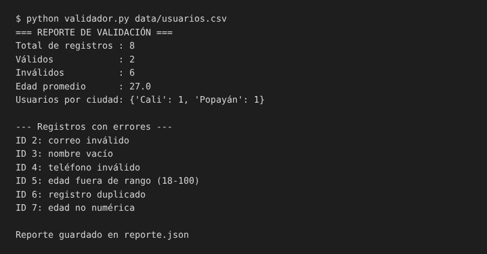

# Validador de datos de usuarios (Python)

Script de línea de comandos que **valida y analiza un archivo CSV de usuarios**: revisa cada registro, detecta
duplicados y genera un reporte en consola y en un archivo JSON. Surgió de automatizar una tarea manual de revisión
de datos.

## Qué hace
- Valida nombre no vacío, correo con formato correcto, celular colombiano (10 dígitos que empiezan en 3) y edad numérica entre 18 y 100.
- Detecta registros duplicados (mismo correo y teléfono).
- Calcula el total de registros válidos e inválidos, la edad promedio y los usuarios por ciudad.
- Exporta el resultado a `reporte.json`.

## Tecnologías
- Python 3.9 o superior (solo biblioteca estándar: `csv`, `re`, `argparse`, `json`, `collections`, `pathlib`)
- `unittest` para las pruebas

## Captura



## Cómo ejecutarlo
```bash
git clone https://github.com/TU-USUARIO/validador-datos-usuarios.git
cd validador-datos-usuarios
python validador.py data/usuarios.csv            # genera reporte.json
python validador.py otro.csv -o mi_reporte.json  # con otro archivo y salida
```

## Pruebas
```bash
python -m unittest discover -s tests -v
```

## Estructura
```
validador-datos-usuarios/
├── validador.py          # lógica y línea de comandos
├── data/usuarios.csv     # datos de ejemplo
├── tests/test_validador.py
└── docs/                 # capturas
```

## Posibles mejoras
- Exportar los registros inválidos a un CSV aparte.
- Soportar archivos Excel (`.xlsx`).
- Agregar más reglas de validación configurables.

## Autor
Jhon Anderson Lasprilla Aponza · [LinkedIn](https://www.linkedin.com/in/jhon-anderson-lasprilla-aponza)
